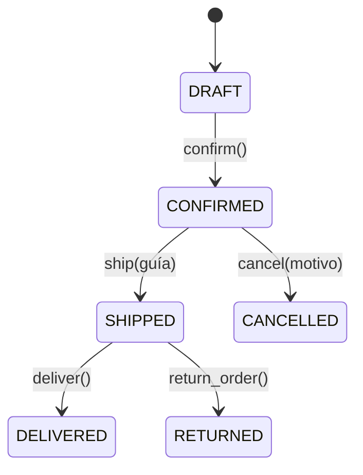

# TechStore U4 · Núcleo de negocio

Actividad 4 — Componentes de lógica de negocios · Equipo 1 · Grupo 002

Implementación del núcleo de negocio de TechStore, una tienda ficticia, con Domain-Driven Design.
El sistema carga clientes, productos y pedidos desde archivos CSV, calcula descuentos con el patrón
Specification, controla el ciclo de vida de cada pedido con una máquina de estados y expone parte
de esa lógica mediante una API REST con FastAPI.

Todo funciona **en memoria**: no hay base de datos, así que al cerrar el programa o reiniciar la API
los pedidos vuelven a su estado inicial (`DRAFT`).

## Integrantes

| Matrícula | Nombre |
| --- | --- |
| 2025292 | José Ángel Leal Sifuentes |
| 2019069 | Cristopher Led Juarez Luna |
| 1908457 | Diego Armando Esparza Flores |

## Estructura del proyecto

```
CLN_U4_TechStore/
  datos/                  # 5 CSV: clientes, productos, pedidos, detalle_pedidos, escenarios
  cargar_csv.py           # convierte los CSV en objetos del dominio
  ejecutar_escenarios.py  # ejecuta E01–E15 y genera docs/bitacora_escenarios.md
  app/
    domain.py             # Money, Customer, OrderItem, Order, DomainEvent y excepciones
    specifications.py     # Specification (AND/OR/NOT), reglas de descuento y discount_rate()
    api.py                # API REST con FastAPI
  tests/
    test_domain.py        # pruebas del dominio (5)
    test_escenarios.py    # pruebas de E01–E15 y de reglas de borde (28)
  docs/
    bitacora_escenarios.md
  requirements.txt
```

## Instalación

Requiere **Python 3.11 o superior**.

```bash
python -m venv .venv
# Windows PowerShell: .venv\Scripts\Activate.ps1
# Windows CMD:        .venv\Scripts\activate.bat
# macOS / Linux:      source .venv/bin/activate
python -m pip install -r requirements.txt
```

Si el comando `python` no se reconoce en Windows, prueba con `py` o con la ruta completa
del ejecutable de Python.

## Ejecución

Todos los comandos se ejecutan desde la carpeta raíz del proyecto, la que contiene `app/` y `datos/`.

```bash
python cargar_csv.py              # muestra los 16 pedidos cargados (todos en DRAFT)
python ejecutar_escenarios.py     # corre E01–E15 y escribe docs/bitacora_escenarios.md
python -m pytest -q               # corre las 33 pruebas automáticas
python -m uvicorn app.api:app --reload   # levanta la API
```

Con la API en marcha, la documentación interactiva (Swagger) está en
<http://127.0.0.1:8000/docs>.

## Reglas de negocio

- `Money` es inmutable, usa `Decimal`, rechaza montos negativos o no finitos y solo suma monedas iguales.
- `OrderItem` exige un SKU no vacío y una cantidad mayor que 0. El subtotal es `precio × cantidad`.
- Un pedido admite como máximo **20 unidades** (suma de cantidades, no número de renglones).
- Solo se agregan artículos mientras el pedido está en `DRAFT` y solo en MXN.
- **Descuento del 10 %:** cliente VIP **y** total mayor a 500 **y** al menos 4 unidades **y** sin promoción activa.
- **Descuento del 5 %:** total mayor a 5000 **y** sin promoción activa.
- Si se cumplen ambas reglas, gana la del 10 %. Con una promoción activa no hay descuento.
- Los umbrales de monto son estrictos (`>`): un total exacto de 500 o de 5000 no activa el descuento.
- No se controla inventario; la existencia del catálogo es solo informativa.

La prioridad entre descuentos se resuelve en un solo lugar: `discount_rate(order)` en
`app/specifications.py`.

## Máquina de estados y Domain Events



| Operación | Requisitos | Evento |
| --- | --- | --- |
| `confirm()` | Estado DRAFT, con artículos y cliente activo | `OrderConfirmed` |
| `ship(guía)` | Estado CONFIRMED y guía no vacía | `OrderShipped` |
| `cancel(motivo)` | Estado CONFIRMED y motivo no vacío | `OrderCancelled` |
| `deliver()` | Estado SHIPPED | `OrderDelivered` |
| `return_order()` | Estado SHIPPED | `OrderReturned` |

En cada método primero se validan las condiciones, después se cambia el estado y, al final, se
registra el evento. Por eso una operación inválida nunca cambia el estado ni deja eventos
registrados.

## API REST

| Método | Ruta | Descripción | Respuestas |
| --- | --- | --- | --- |
| GET | `/orders/{order_id}` | Consulta un pedido: id, estado, unidades y total | 200, 404 |
| POST | `/orders/{order_id}/confirm` | Confirma el pedido | 200, 404, 409, 422 |
| POST | `/orders/{order_id}/ship` | Cuerpo: `{"tracking_number": "..."}` | 200, 404, 409, 422 |
| POST | `/orders/{order_id}/cancel` | Cuerpo: `{"reason": "..."}` | 200, 404, 409, 422 |

Códigos de error:

- **404:** el pedido no existe.
- **409:** la transición no está permitida desde el estado actual (`InvalidOrderTransition`).
- **422:** los datos violan una regla del negocio, como un cliente inactivo, un pedido vacío o una guía vacía (`InvalidOrderData`).

Los identificadores de pedido llevan la letra **O** mayúscula (por ejemplo `O001`), no el número cero.

## Pruebas

Hay **33 pruebas** con pytest:

- `tests/test_domain.py`: 5 pruebas del dominio.
- `tests/test_escenarios.py`: 28 pruebas, una por cada escenario E01–E15 más reglas de borde (umbrales de 500 y 5000, límite de 20 unidades, estados finales, validaciones de `Money` y `OrderItem`).

```bash
python -m pytest -v
```

Los 15 escenarios (`datos/escenarios.csv`) se ejecutan con `ejecutar_escenarios.py`. Los descuentos
se calculan con las Specifications y no están escritos a mano; el resultado queda en
`docs/bitacora_escenarios.md`.

## Alcance

Quedan fuera de esta práctica la persistencia en base de datos y el control de inventario.
